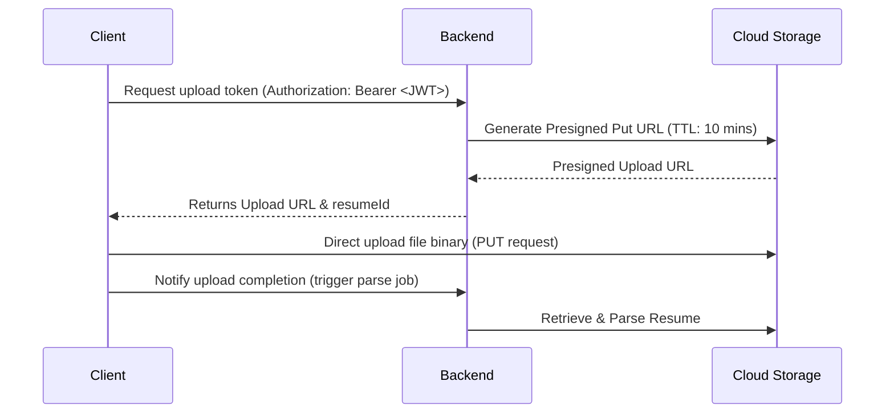

# Cloud Storage Migration Plan - AWS S3 & Google Cloud Storage (GCS)

This document presents a production-ready cloud storage architecture for **SkillSync AI** to migrate from local file uploads to secure, scalable cloud object storage.

---

## 1. Storage Architecture & Folder Organization

To prevent path traversal, name collisions, and resource leaking, we structure the bucket as follows:

```
skillsync-resumes-prod/
├── applicants/
│   └── {userId}/
│       └── {resumeId}/
│           ├── original_{sanitized_name}.pdf
│           └── parsed_text.json
├── jobs/
│   └── {jobId}/
│       └── job_description.pdf
└── temp/
    └── {uploadToken}/
        └── raw_upload.docx
```

### Folder Layout Breakdown
1. **`applicants/{userId}/{resumeId}/`**: Isolates each applicant's uploaded documents. The use of `{resumeId}` guarantees that multiple uploads by the same user do not overwrite previous documents, allowing historical version tracking.
2. **`temp/`**: Direct-to-bucket client uploads land here. Lifecycle rules automatically delete these files after 24 hours if they are not processed and moved to permanent directories.

---

## 2. Secure Access Control (Signed URLs)

**Rule**: Public access to the bucket is completely disabled. All read/write operations must happen via **IAM-authorized Signed URLs** with short time-to-live (TTL) limits (e.g., 15 minutes).

### Client Upload Flow (Secure Presigned URL)


---

## 3. Production-Ready Storage Wrapper

This modular service abstractly implements support for both **Google Cloud Storage (GCS)** and **Amazon S3**.

```javascript
const { Storage } = require('@google-cloud/storage');
const { S3Client, PutObjectCommand, GetObjectCommand, DeleteObjectCommand } = require('@aws-sdk/client-s3');
const { getSignedUrl } = require('@aws-sdk/s3-request-presigner');

class CloudStorageService {
    constructor() {
        this.provider = process.env.CLOUD_STORAGE_PROVIDER || 'gcs'; // 'gcs' or 's3'
        
        if (this.provider === 'gcs') {
            this.gcsClient = new Storage({
                projectId: process.env.GCLOUD_PROJECT_ID,
                keyFilename: process.env.GCS_KEYFILE_PATH
            });
            this.bucketName = process.env.GCS_BUCKET_NAME;
        } else {
            this.s3Client = new S3Client({
                region: process.env.AWS_REGION,
                credentials: {
                    accessKeyId: process.env.AWS_ACCESS_KEY_ID,
                    secretAccessKey: process.env.AWS_SECRET_ACCESS_KEY
                }
            });
            this.bucketName = process.env.AWS_BUCKET_NAME;
        }
    }

    /**
     * Generates a secure, short-lived Signed URL for uploading a file directly from frontend
     */
    async getUploadPresignedUrl(filePath, contentType, ttlSeconds = 600) {
        if (this.provider === 'gcs') {
            const options = {
                version: 'v4',
                action: 'write',
                expires: Date.now() + ttlSeconds * 1000,
                contentType: contentType,
            };
            const [url] = await this.gcsClient
                .bucket(this.bucketName)
                .file(filePath)
                .getSignedUrl(options);
            return url;
        } else {
            const command = new PutObjectCommand({
                Bucket: this.bucketName,
                Key: filePath,
                ContentType: contentType
            });
            return getSignedUrl(this.s3Client, command, { expiresIn: ttlSeconds });
        }
    }

    /**
     * Generates a secure Read-Only URL to display or parse the file safely
     */
    async getReadPresignedUrl(filePath, ttlSeconds = 900) {
        if (this.provider === 'gcs') {
            const options = {
                version: 'v4',
                action: 'read',
                expires: Date.now() + ttlSeconds * 1000,
            };
            const [url] = await this.gcsClient
                .bucket(this.bucketName)
                .file(filePath)
                .getSignedUrl(options);
            return url;
        } else {
            const command = new GetObjectCommand({
                Bucket: this.bucketName,
                Key: filePath
            });
            return getSignedUrl(this.s3Client, command, { expiresIn: ttlSeconds });
        }
    }

    /**
     * Deletes a file from the bucket (useful on profile deletion or file update)
     */
    async deleteFile(filePath) {
        if (this.provider === 'gcs') {
            await this.gcsClient.bucket(this.bucketName).file(filePath).delete();
        } else {
            const command = new DeleteObjectCommand({
                Bucket: this.bucketName,
                Key: filePath
            });
            await this.s3Client.send(command);
        }
    }
}

module.exports = new CloudStorageService();
```

---

## 4. Lifecycle Policies

To control costs and automate data purging, configure these lifecycle actions:

### AWS S3 Lifecycle Policy JSON
```json
{
  "Rules": [
    {
      "ID": "MoveOlderResumesToColdStorage",
      "Status": "Enabled",
      "Filter": {
        "Prefix": "applicants/"
      },
      "Transitions": [
        {
          "Days": 90,
          "StorageClass": "INTELLIGENT_TIERING"
        },
        {
          "Days": 180,
          "StorageClass": "GLACIER"
        }
      ]
    },
    {
      "ID": "PurgeTempUploads",
      "Status": "Enabled",
      "Filter": {
        "Prefix": "temp/"
      },
      "Expiration": {
        "Days": 1
      }
    }
  ]
}
```

### Google Cloud Storage Lifecycle Policy JSON
```json
{
  "lifecycle": {
    "rule": [
      {
        "action": {
          "type": "SetStorageClass",
          "storageClass": "NEARLINE"
        },
        "condition": {
          "age": 90,
          "matchesPrefix": ["applicants/"]
        }
      },
      {
        "action": {
          "type": "Delete"
        },
        "condition": {
          "age": 1,
          "matchesPrefix": ["temp/"]
        }
      }
    ]
  }
}
```

---

## 5. Cost Considerations & Optimization Recommendations

1. **Intelligent Tiering / Class Transitioning**: Resumes are infrequently updated but frequently queried during active recruiting cycles. Move files older than 90 days to GCS Nearline or AWS Intelligent Tiering to save up to 40% on storage baseline costs.
2. **Direct Browser Uploads**: By letting the client upload files directly to GCS/S3 via Presigned Write URLs, you bypass the Node.js application server. This eliminates double-transfer egress costs, prevents server RAM exhaustion during large uploads, and slashes EC2/ECS resource requirements.
3. **Data Compression**: Store parsed text as compressed GZIP JSON files. This reduces the text metadata storage footprints by ~70%.
